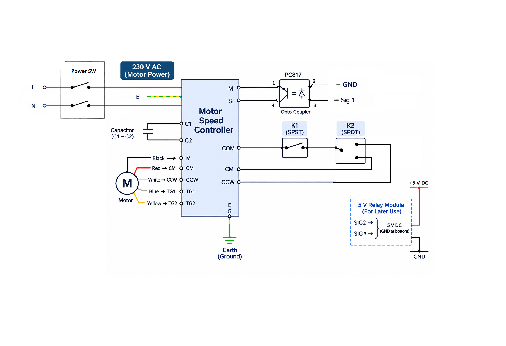

# Conveyor Belt System – User Manual

## 1. Overview

This document describes the operation of the conveyor belt system, including its operating procedures, electrical control architecture, and updated microcontroller (MCU) interface.

The conveyor belt system has been re-engineered to support external microcontroller-based control. The updated design allows the conveyor motor to be operated using low-voltage control signals without requiring direct interaction with the 230 V AC motor supply during normal control operations.

## 2. System Description

The conveyor belt consists of the following main functional sections:

Conveyor belt and drive mechanism.

AC motor and motor speed controller.

Re-engineered electronic control module.

Low-voltage signal interface.

External microcontroller (MCU) interface.

230 V AC motor power supply.

The updated control module provides an interface for controlling the motor's operating direction and speed using an external MCU system.

## 3. Important Notice – Re-engineered Control Module

The original control system has been modified and is no longer installed in its original configuration.

The original control components and associated parts that are no longer required have been removed as part of the redesign.

The original electrical circuit was studied, the circuit-board connections were identified, and the control architecture was reverse-engineered.

The entire control wiring section was subsequently redesigned and re-engineered by Rashmika Dineth Ruwanpathirana.

The main objectives of the redesign were:

To identify and understand the original circuit-board connections.

To separate the high-voltage (230 V AC) motor power section from the low-voltage control-signal section.

To redesign the control interface for external MCU compatibility.

To allow motor speed and direction to be controlled using low-voltage signals.

To make the conveyor compatible with different microcontroller platforms.

The redesigned system allows an external MCU to control the conveyor through the updated wiring interface, without requiring direct access to the 230 V AC supply for normal control operations.

Important: The updated wiring diagram included in this repository must be followed instead of the original manufacturer's control wiring diagram.

## 4. Updated Wiring Diagram

The updated wiring diagram illustrates the redesigned control module and its connections to the conveyor motor speed controller.

Wiring diagram:

The diagram identifies:

High-voltage motor power connections.

Isolated low-voltage control section.

MCU control-signal connections.

Motor direction-control interface.

Motor speed-control interface.

Signal reference and ground connections.

Refer to the updated wiring diagram before connecting an external microcontroller.

## 5. Operating Instructions

The detailed operating procedure will follow the original manufacturer's user manual, with the necessary modifications for the redesigned MCU control interface.

5.1 Before Starting

Ensure that the conveyor belt is mechanically clear.

Check that no objects or foreign materials obstruct the belt.

Inspect the motor, conveyor belt and mechanical components.

Check that the electrical connections are secure.

Verify that the updated control module is correctly connected.

Ensure that the external MCU is configured correctly.

Confirm that the emergency-stop and other applicable safety arrangements are functional.

## 5.2 Powering On

Connect the conveyor system to its designated power supply.

Ensure that the external MCU is powered and initialised.

Verify that the control signals are in their intended initial states.

Confirm that the motor remains stopped until a valid operating command is provided.

Start the conveyor using the external control system.

## 5.3 Controlling Motor Direction

The motor direction can be controlled through the low-voltage signal interface.

The external MCU must generate the appropriate control signals according to the updated wiring diagram.

The exact signal states and direction-selection procedure will be documented after reviewing the final wiring diagram and original user manual.

## 5.4 Controlling Motor Speed

Motor speed can be adjusted through the speed-control signal interface.

The redesigned module supports speed adjustment using an input voltage applied to the designated speed-control signal and its reference connection (GND).

The external MCU can therefore control motor speed by providing an appropriate control voltage through a compatible signal-conditioning interface.

Note: The permitted input-voltage range and corresponding motor-speed characteristics must be confirmed from the final electrical documentation before operation.

## 5.5 Stopping the Conveyor

Send a stop command through the external MCU.

Verify that the motor has stopped completely.

Disconnect the main power supply when the system is no longer required.

Wait for all moving components to come to a complete stop before performing inspection or maintenance.

## 6. MCU Compatibility

The updated control module was designed to support integration with different microcontroller platforms.

Potential platforms include:

    - Arduino UNO / Mega.

    - ESP32.

    - STM32.

    - Raspberry Pi Pico.

    - Other compatible MCU development boards.

The selected MCU must provide electrically compatible control signals. Use the below characteristics for the input signal pins. 

.PNG)
.PNG)

> **Important**: Do not connect an MCU GPIO directly to the control module until the input-voltage requirements, current limits, signal reference and isolation arrangements have been verified.

## 7. Safety Precautions

WARNING – 230 V AC ELECTRICAL SUPPLY

The conveyor motor operates using mains voltage. Although the control interface has been redesigned to operate through a low-voltage signal section, the motor power section still contains hazardous voltage.

Observe the following precautions:

Never touch exposed 230 V AC connections.

Do not modify electrical connections while the system is powered.

Disconnect and isolate the mains supply before maintenance.

Ensure that the high-voltage and low-voltage sections remain properly separated.

Do not bypass protective or safety devices.

Keep hands, clothing and loose objects away from moving conveyor components.

Only suitably qualified personnel should work on the mains-voltage section.

The low-voltage control interface does not mean that the entire conveyor system is electrically safe to touch.

## 8. Troubleshooting

| Problem | Possible Cause | Recommended Action |
|---|---|---|
| Motor does not start | Missing power or enable signal | Check the power supply and control signals. |
| Motor does not change direction | Incorrect direction-control signal | Verify MCU output and wiring. |
| Motor speed does not change | Incorrect speed-control voltage | Check the signal input and reference connection. |
| Motor operates unexpectedly | Incorrect MCU initialisation or signal state | Verify the startup and control logic. |
| Unstable motor operation | Electrical interference or incorrect signal reference | Inspect signal wiring and grounding. |

> **Safety Warning:** Disconnect the power supply before inspecting or modifying electrical connections.

## 9. Documentation and Project Files

[Download the User Manual of Vevor Belt Conveyer ](VEVOR_BELT_CONVEYER.pdf)

## 10. Engineering and Modification Credits

System reverse engineering and control-module redesign:

Rashmika Dineth Ruwanpathirana

The original conveyor control circuit was investigated and reverse-engineered. The control wiring was redesigned to separate the high-voltage motor power section from the low-voltage control interface.

The updated module provides a flexible MCU-compatible control architecture, enabling motor direction and speed to be controlled using external microcontroller systems.

The modified system was functionally tested, and the motor successfully operated with controllable direction and speed.

Document Type: Conveyor Belt User Manual
System: Re-engineered MCU-Compatible Conveyor Belt
Control Interface: Low-Voltage MCU Signal Interface
Motor Supply: 230 V AC
Engineering Modification: Rashmika Dineth Ruwanpathirana